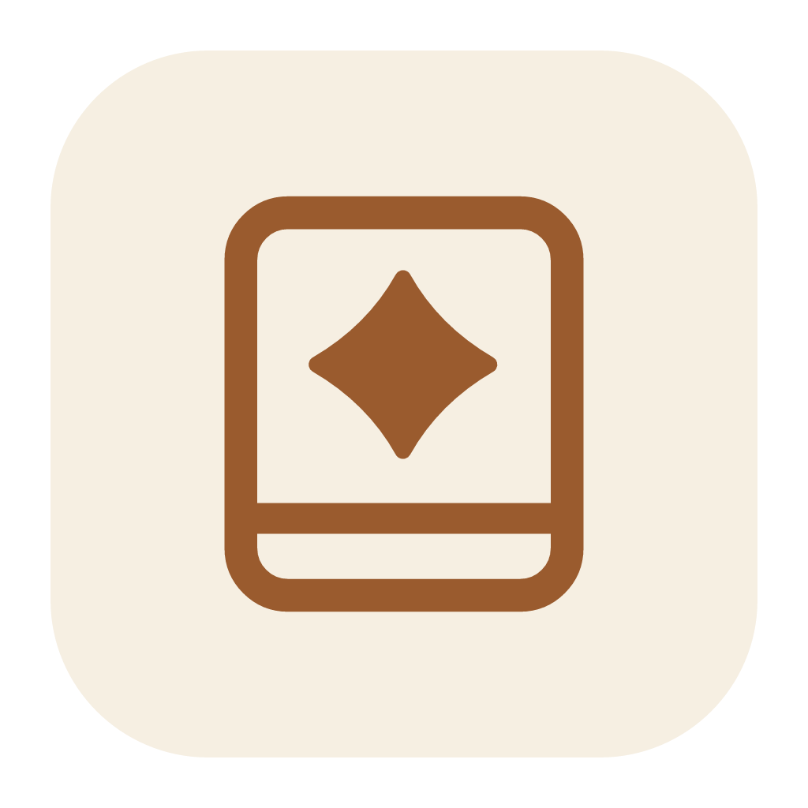

<p align="center"></p>

# dhyāna

A quiet, offline-first journal. Your entries are plain markdown files in a folder you choose; AI is optional and not part of this release.


- **Opens to today.** One note per day, created only when you start typing.
- **Plain files.** `journal/2026/10/2026-10-28.md`: readable in Obsidian, VS Code, anywhere.
- **Lossless.** Your markdown is never reformatted. Only the parts you edit change.
- **Mood check-ins.** A quick "how are you feeling?" once a day, saved in the note's frontmatter, with a year heatmap of words and mood.
- **Version history.** Every note's past versions with a diff and one-click restore, kept outside your vault.
- **Keyboard-first.** Press <kbd>Ctrl</kbd>/<kbd>⌘</kbd> + <kbd>K</kbd> for everything.

<p>
  
  
</p>

## Quick start

Requires [Node 20+](https://nodejs.org), [pnpm](https://pnpm.io), and [Rust](https://rustup.rs) (plus the [Tauri prerequisites](https://tauri.app/start/prerequisites/) for your OS).

```sh
pnpm install
pnpm tauri dev
```

Pick a vault folder on first launch, then start writing.

## Learn more

|                                                                         |                                       |
| ----------------------------------------------------------------------- | ------------------------------------- |
| [Getting started](docs/getting-started.md)                              | Install, run, test, build             |
| [Keyboard shortcuts](docs/keyboard-shortcuts.md)                        | Every shortcut                        |
| [Vault format](docs/vault-format.md)                                    | Files, frontmatter, markdown fidelity |
| [Mobile](docs/mobile.md)                                                | Capture on your phone with Obsidian   |
| [Tech stack](docs/tech-stack.md) · [Architecture](docs/architecture.md) | How it's built                        |
| [Development](docs/development.md) · [Design](docs/design.md)           | Tooling, CI, themes, conventions      |
| [Plans](docs/plans/00-master-plan.md)                                   | Roadmap and decisions                 |
