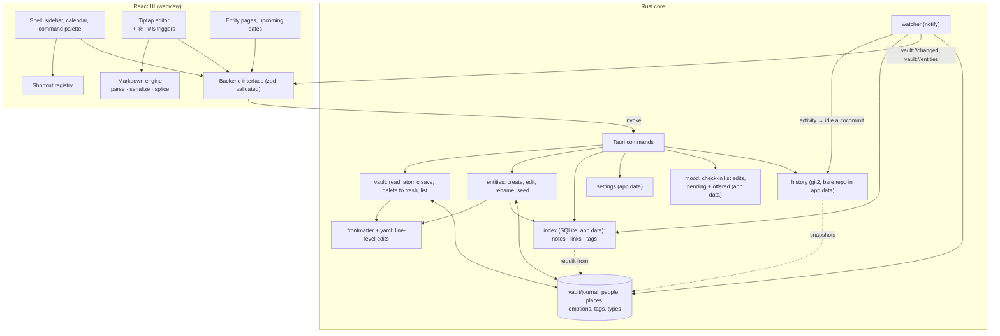

# Architecture

## Responsibilities

- **Markdown engine** (`src/markdown/`): turns a note body into an editor document and remembers the exact source of every top-level block. On save, blocks that are unchanged are spliced back byte-for-byte; only edited blocks are re-serialized. Constructs the editor has no node for (tables, footnotes, raw HTML, AI blocks) are carried as opaque blocks. `[[wikilinks]]` are inline atoms.
- **Editor triggers** (`src/editor/`): the `@ ! # $` pickers as one Tiptap extension. What each offers is a set of pure functions (`suggest.ts`) so it can be tested without an editor.
- **Rust core** (`src-tauri/`): owns the files. Splits frontmatter from body, edits single frontmatter lines (never re-emitting YAML), writes atomically (temp file + rename), refuses to overwrite a file that changed on disk (hash check), and reports external changes through the watcher.
- **Entities** (`entities.rs`, `names.rs`, `links.rs`): people, places, emotions and tags are notes. Creating, editing and renaming them follows the name rules in the [master plan](plans/00-master-plan.md#4a-name-collisions-decided); rename rewrites links with the same scanner the index uses.
- **Index** (`index.rs`): a SQLite file in app data, keyed by vault id. It is derived entirely from the files, brought up to date on launch, and refreshed per file by the watcher and after saves. Deleting it loses nothing.
- **Mood** (`mood.rs`, `src/lib/mood.ts`): reads and edits the `mood:` frontmatter list one item at a time (unchanged items are kept byte-for-byte), and keeps per-device state in app data: check-ins waiting for their day file, and which days the check-in was already offered.
- **History** (`history.rs`): a bare Git repository in app data per vault. Commits are built straight from the files (blobs and trees), with no Git index or checkout, so nothing is written into the vault and a user's own `.git` is never touched. A version is recorded after a pause in writing (and every few minutes of continuous writing, and on quit) and never amended. Checkpoints are versions made on request with a reason (restores use them; AI edits will in 0.6). Per-note version lists and restore.
- **Backend interface** (`src/lib/backend.ts`): the only way the UI touches the core. Outside Tauri (plain `pnpm dev`) an in-memory implementation is used instead, with the same name rules and link scanning (`memoryBackend.ts`, `memoryEntities.ts`).
- **Schema layer** (`src/lib/schema.ts`): zod types for built-in note types and for everything that crosses the Rust boundary. Rust validates the same rules when writing.
- **Shortcut registry** (`src/lib/shortcuts.ts`, `src/app/actions.ts`): one list of actions feeds the palette, tooltips, the shortcuts page, and the key handler.

Principles are in the [master plan](plans/00-master-plan.md#2-principles): files are the truth, lossless round-trip, AI optional.
