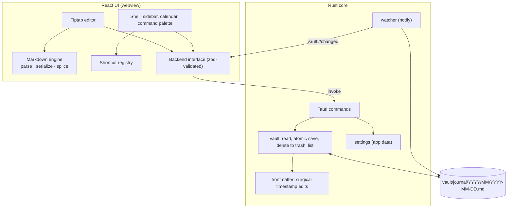

# Architecture

## Responsibilities

- **Markdown engine** (`src/markdown/`): turns a note body into an editor document and remembers the exact source of every top-level block. On save, blocks that are unchanged are spliced back byte-for-byte; only edited blocks are re-serialized. Constructs the editor has no node for (tables, footnotes, raw HTML, AI blocks) are carried as opaque blocks.
- **Rust core** (`src-tauri/`): owns the files. Splits frontmatter from body, updates only the `modified` line, writes atomically (temp file + rename), refuses to overwrite a file that changed on disk (hash check), and reports external changes through the watcher.
- **Backend interface** (`src/lib/backend.ts`): the only way the UI touches the core. Outside Tauri (plain `pnpm dev`) an in-memory implementation is used instead.
- **Shortcut registry** (`src/lib/shortcuts.ts`, `src/app/actions.ts`): one list of actions feeds the palette, tooltips, the shortcuts page, and the key handler.

Principles are in the [master plan](plans/00-master-plan.md#2-principles): files are the truth, lossless round-trip, AI optional.
